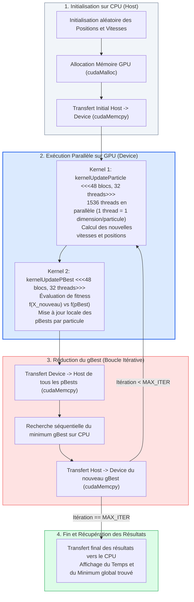

# Analyse Globale du Projet CUDA-PSO & Architecture GPU

## 1. Contexte Académique et Objectifs du Projet

Ce document présente une analyse exhaustive et détaillée du projet de calcul haute performance **CUDA-PSO** (Particle Swarm Optimization sur GPU), développé dans le cadre du cours de calcul parallèle (Master IM & IMDS à l'Université de Haute-Alsace - UHA, sous la direction du Pr. Lhassane Idoumghar).

### 1.1 Objectifs principaux
1. **Comprendre et analyser** la mise en œuvre de l'algorithme d'optimisation par essaim particulaire (PSO - *Particle Swarm Optimization*) sur architecture parallèle GPU via NVIDIA CUDA.
2. **Identifier les choix d'architecture**, le modèle d'exécution, la gestion mémoire, les goulots d'étranglement et les vulnérabilités de l'implémentation existante.
3. **Préparer la transition/extension** vers d'autres métaheuristiques massivement parallèles, notamment **l'Évolution Différentielle** (DE - *Differential Evolution*), en s'appuyant sur le cours CUDA et les travaux de recherche de référence (*Qin et al., "An Improved CUDA-Based Implementation of Differential Evolution on GPU"*).

---

## 2. Rappels Ciblés d'Architecture GPU & Contraintes d'Exécution

Pour appréhender les gains et les limites d'une métaheuristique sur GPU, trois caractéristiques clés de l'architecture NVIDIA CUDA doivent être retenues :

1. **Modèle SIMT (Single Instruction, Multiple Threads) et Hiérarchie de Calcul** :
   * Les threads sont regroupés physiquement en **Warps de 32 threads** exécutés de concert sur les *Streaming Multiprocessors* (SM).
   * L'indexation globale 1D associe chaque thread à une donnée :
     $$\text{gtid} = \text{blockIdx.x} \times \text{blockDim.x} + \text{threadIdx.x}$$
   * Tout branchement divergent (`if/else`) au sein d'un même warp sérialise l'exécution (**Divergence de Warp**) et dégrade les performances.

2. **Hiérarchie Mémoire & Coalescence** :
   * **Mémoire Globale (DRAM)** : Espace principal mais à forte latence (400 à 800 cycles). Les accès doivent être **coalescents** (les threads consécutifs accèdent à des adresses consécutives en mémoire).
   * **Mémoire Partagée (`__shared__`)** : Mémoire ultra-rapide sur la puce (1 à 2 cycles), accessible par tous les threads d'un même bloc pour les réductions et le partage d'individus.

3. **Coût Critique des Transferts Bus PCI-e** :
   * Les échanges `cudaMemcpy(Host <-> Device)` sont particulièrement lents comparés à la bande passante interne du GPU. Une parallélisation efficace impose de **conserver l'intégralité de la boucle itérative sur le GPU** pour éviter les transferts répétés.

---

## 3. Principe de l'Algorithme PSO et Architecture du Code `cudapso`

### 3.1 Principe Fondamental du Particle Swarm Optimization (PSO)

Proposé initialement par Kennedy et Eberhart (1995), le PSO s'inspire du comportement social et collectif des nuées d'oiseaux ou des bancs de poissons à la recherche d'une source de nourriture.

#### 1. Modélisation de l'Essaim (Swarm)
Un essaim est constitué de $N$ individus appelés **particules** évoluant dans un espace de recherche continu à $D$ dimensions :
* **Position courante** de la particule $i$ au temps $t$ :
  $$X_i^t = (x_{i,1}^t, x_{i,2}^t, \dots, x_{i,D}^t) \in \mathbb{R}^D$$
* **Vitesse de déplacement** de la particule $i$ :
  $$V_i^t = (v_{i,1}^t, v_{i,2}^t, \dots, v_{i,D}^t) \in \mathbb{R}^D$$
* **Meilleure position personnelle historique ($pBest$)** trouvée par la particule $i$ :
  $$pBest_i = (p_{i,1}, p_{i,2}, \dots, p_{i,D}), \quad \text{tel que } f(pBest_i) = \min_{\tau \le t} f(X_i^\tau)$$
* **Meilleure position globale de l'essaim ($gBest$)** partagée par toutes les particules :
  $$gBest = \arg\min_{i \in \{1 \dots N\}} f(pBest_i)$$

#### 2. Équations Mathématiques du Mouvement
À chaque génération $t+1$, la trajectoire de chaque particule est ajustée en fonction de son élan propre, de sa mémoire individuelle et de l'influence collective :

$$\begin{cases}
v_{i,d}^{t+1} = \underbrace{\omega \cdot v_{i,d}^t}_{\text{Inertie}} + \underbrace{c_1 \cdot r_1 \cdot (pBest_{i,d} - x_{i,d}^t)}_{\text{Composante Cognitive (Mémoire)}} + \underbrace{c_2 \cdot r_2 \cdot (gBest_d - x_{i,d}^t)}_{\text{Composante Sociale (Collectif)}} \\
x_{i,d}^{t+1} = x_{i,d}^t + v_{i,d}^{t+1}
\end{cases}$$

Où :
* $\omega \in ]0, 1]$ est le **facteur d'inertie** : contrôle l'équilibre exploration (valeurs élevées) / exploitation (valeurs faibles).
* $c_1, c_2$ sont les **coefficients d'accélération** (cognitif et social) : pondèrent l'attraction vers $pBest_i$ et $gBest$.
* $r_1, r_2 \sim \mathcal{U}(0, 1)$ sont des **variables aléatoires indépendantes** apportant la stochasticité nécessaire pour franchir les optima locaux.

---

### 3.2 Fonctionnement du Code Source et Organisation Mémoire

Le projet `cudapso` se compose des modules suivants :
* [kernel.h](file:///c:/Users/youne/Documents/Projetcmp/ProjetCmp/kernel.h) : Définition des paramètres de l'essaim ($N = 512$, $D = 3$), coefficients ($\omega = 0.5, c_1 = c_2 = 1.5$) et prototypes.
* [kernel.cu](file:///c:/Users/youne/Documents/Projetcmp/ProjetCmp/kernel.cu) : Implémentation des kernels CUDA (`kernelUpdateParticle`, `kernelUpdatePBest`) et orchestration Host-Device (`cuda_pso`).
* [kernel.cpp](file:///c:/Users/youne/Documents/Projetcmp/ProjetCmp/kernel.cpp) : Fonctions de fitness exécutées sur le CPU pour le calcul de $gBest$.
* [main.cpp](file:///c:/Users/youne/Documents/Projetcmp/ProjetCmp/main.cpp) : Point d'entrée, initialisation de la population, mesure du temps (`clock()`) et affichage.
* [CudaPSO.ipynb](file:///c:/Users/youne/Documents/Projetcmp/ProjetCmp/CudaPSO.ipynb) : Environnement d'exécution et de test sur GPU Google Colab.

#### Linéarisation Mémoire 1D :
Pour convenir à l'architecture GPU, la matrice bidimensionnelle des particules ($N \times D = 512 \times 3 = 1536$ scalaires) est aplatie sous forme d'un tableau continu 1D en mémoire globale (`float *devPos`, `float *devVel`, `float *devPBest`) :
* **Indice de la particule** : $\lfloor i / D \rfloor$
* **Indice de la dimension** : $i \pmod D$

---

### 3.3 Diagramme de Fonctionnement du PSO Parallèle sur GPU

Le schéma ci-dessous illustre le pipeline d'exécution de l'algorithme PSO tel qu'implémenté dans le projet, mettant en évidence la répartition du travail entre le CPU (Host) et les cœurs GPU (Device) :



#### Schéma d'Exécution Physique par Thread :

```
 Grille GPU : 48 Blocs de 32 Threads = 1536 Threads actifs simultanés
 +---------------------------------------------------------------------------------------+
 | Thread ID (i) : [ 0 ]   [ 1 ]   [ 2 ]  |  [ 3 ]   [ 4 ]   [ 5 ]  | ... | [ 1535 ]     |
 | Particule     : P0      P0      P0     |  P1      P1      P1     | ... | P511         |
 | Dimension     : Dim 0   Dim 1   Dim 2  |  Dim 0   Dim 1   Dim 2  | ... | Dim 2        |
 +---------------------------------------------------------------------------------------+
                                           |
                +--------------------------+--------------------------+
                |                                                     |
                v (Kernel 1 : Parallélisme Total)                     v (Kernel 2 : Filtrage)
      Calcul simultané des vitesses                          Seuls les threads où i % D == 0
       et positions pour chaque                              évaluent la fonction fitness
       composante scalaire (SIMT)                            pour la particule correspondante
```

---

### 3.4 Description Détaillée des Kernels et Fonctions Objectifs

#### 1. Kernel `kernelUpdateParticle`
* Déclenché avec une grille de `blocksNum = 48` et `threadsNum = 32` ($48 \times 32 = 1536$ threads).
* Chaque thread traite directement la composante $i$ en accédant aux tableaux contigus en mémoire globale.
* Accède à $gBest[i \pmod D]$ pour appliquer la composante sociale.

#### 2. Kernel `kernelUpdatePBest`
* Effectue l'évaluation de fitness sur le GPU via `fitness_function(x)`.
* Seuls les threads dont l'indice vérifie `i % NUM_OF_DIMENSIONS == 0` (soit le premier thread de chaque particule) réalisent l'évaluation et la comparaison avec l'ancien $pBest$.

#### 3. Fonctions Benchmark Intégrées
Le code implémente 5 fonctions objectifs d'optimisation numérique (définies dans `kernel.cu` et `kernel.cpp`), sélectionnées via `SELECTED_OBJ_FUNC` :
1. **Levy 3D** ($F_0$) : Multimodale complexe, minimum théorique $f(x^*) = 0$.
2. **Shifted Rastrigin** ($F_1$) : Hautement multimodale, nombreuses trappes locales, décalée de $-330$.
3. **Shifted Rosenbrock** ($F_2$) : Vallée étroite non-séparable, décalée de $+390$.
4. **Shifted Griewank** ($F_3$) : Nombreux minima locaux réguliers avec terme produit, décalée de $-180$.
5. **Shifted Sphere** ($F_4$) : Fonction unimodale convexe servant de référence de convergence, décalée de $-450$.

---

## 4. Analyse Critique : Vulnérabilités, Goulots d'Étranglement et Erreurs de Conception

Bien que le code fonctionne de manière basique, une analyse approfondie révèle plusieurs **défauts majeurs de performance et de correction logicielle** :

```
                  +----------------------------------------------+
                  |  PROBLÈMES MAJEURS DANS L'ARCHITECTURE DE   |
                  |                CUDAPSO EXISTANT              |
                  +----------------------------------------------+
                                         |
     +-------------------+---------------+-------------------+-------------------+
     |                   |                                   |                   |
     v                   v                                   v                   v
+-----------------+ +-------------------------+ +------------------------+ +------------------------+
| GOULOT PCI-E    | | DATA RACE CRITIQUE      | | DIVERGENCE & SOUS-     | | GÉNÉRATEUR ALÉATOIRE   |
| 60 000 transferts | | tempParticle1/2 sont   | | UTILISATION DE THREADS | | CPU (rand()) passé en |
| Host<->Device   | | __device__ globaux !    | | seuls 1/3 threads     | | arguments identiques  |
| dans la boucle! | | Undefined Behavior !    | | travaillent pBest!    | | à tous les threads ! |
+-----------------+ +-------------------------+ +------------------------+ +------------------------+
```

### 4.1 Vulnérabilité Majeure 1 : Condition de Course (Data Race Hazard)
Dans [kernel.cu](file:///c:/Users/youne/Documents/Projetcmp/ProjetCmp/kernel.cu#L8-L9) :
```cuda
__device__ float tempParticle1[NUM_OF_DIMENSIONS];
__device__ float tempParticle2[NUM_OF_DIMENSIONS];
```
* Ces deux tableaux sont déclarés en **mémoire globale device** sans portée restreinte par thread.
* Lorsque 512 threads (1 par particule) exécutent `kernelUpdatePBest` en parallèle, **tous les threads écrivent simultanément dans les mêmes cases mémoire `tempParticle1` et `tempParticle2`** !
* **Conséquence** : Destruction des données par chevauchement (Data Race), entraînant un comportement indéterminé (*Undefined Behavior*) et des erreurs de calcul graves.
* **Correction requise** : Déclarer les tableaux temporaires en mémoire locale au thread (`float tempParticle1[NUM_OF_DIMENSIONS];` à l'intérieur du kernel) ou utiliser la mémoire partagée (`__shared__`).

---

### 4.2 Goulot d'Étranglement 2 : Transferts PCI-e Excessifs dans la Boucle Principale
Dans la boucle principal de `cuda_pso` :
```cpp
for (int iter = 0; iter < MAX_ITER; iter++) {
    ...
    cudaMemcpy(pBests, devPBest, sizeof(float)*size, cudaMemcpyDeviceToHost);
    // Calcul de gBest sur CPU...
    cudaMemcpy(devGBest, gBest, sizeof(float)*NUM_OF_DIMENSIONS, cudaMemcpyHostToDevice);
}
```
* Pour `MAX_ITER = 30 000`, le programme effectue **60 000 transferts synchrone à travers le bus PCI-e**.
* La latence du bus PCI-e ruine complètement les performances du GPU.
* **Correction requise** : Conserver l'intégralité du calcul de $gBest$ sur GPU grâce à un kernel de réduction parallèle (*Parallel Reduction*).

---

### 4.3 Inefficacité 3 : Divergence de Threads et Faible Occupancy
Dans `kernelUpdatePBest` :
```cuda
if(i >= NUM_OF_PARTICLES * NUM_OF_DIMENSIONS || i % NUM_OF_DIMENSIONS != 0)
    return;
```
* Seul 1 thread sur 3 (pour $D=3$) effectue un travail utile. Les 2/3 des threads créés s'arrêtent immédiatement.
* La structure de bloc `threadsNum = 32` ne permet pas d'exploiter la pleine capacité d'un SM (qui accepte jusqu'à 2048 threads résidents).

---

### 4.4 Inefficacité 4 : Génération Aléatoire Centrée CPU
* Le Host génère deux nombres aléatoires `r1 = getRandomClamped()` et `r2 = getRandomClamped()` et les passe en argument au kernel `kernelUpdateParticle`.
* Par conséquent, **tous les threads et toutes les particules reçoivent exactement les mêmes coefficients aléatoires $r_1$ et $r_2$** au cours d'une itération donnée.
* **Correction requise** : Utiliser la bibliothèque CUDA **cuRAND** (`curand_uniform`) pour fournir des nombres aléatoires indépendants par particule et par dimension.

---

## 5. Spécifications pour l'Extension vers Differential Evolution (DE) & Architecture Optimisée
*(Inspiré de l'article de référence `An_Improved_CUDA-Based-Implementation_of_Different.pdf`)*

Pour faire évoluer le projet vers l'Évolution Différentielle (DE) et corriger les défauts identifiés, l'architecture doit respecter les principes suivants :

```
                  +----------------------------------------------+
                  |    ARCHITECTURE CUDADEi AMÉLIORÉE PROPOSÉE   |
                  +----------------------------------------------+
                                         |
     +-------------------+---------------+-------------------+
     |                                   |                   |
     v                                   v                   v
+------------------------+   +-----------------------+   +-----------------------+
| FUSION DES KERNELS     |   + GÉNÉRATION ALÉATOIRE  |   | GESTION PAR STREAMS   |
| Combine Mutation,      |   | GPU VIA CURAND        |   | Executions asynchrones|
| Crossover, Évaluation, |   | Indépendance totale   |   | et masquage des       |
| Sélection (MCER)       |   | des threads GPU       |   | latences mémoire      |
+------------------------+   +-----------------------+   +-----------------------+
```

### 5.1 Principes Algorithmiques de l'Évolution Différentielle (DE/rand/1/bin)
Pour chaque vecteur cible $x_i$ ($i = 1 \dots N$) :
1. **Mutation** : Choix de 3 individus distincs $r1, r2, r3 \neq i$ :
   $$v_i = x_{r1} + F \cdot (x_{r2} - x_{r3})$$
2. **Crossover Binomial** :
   $$u_{i,j} = \begin{cases} v_{i,j} & \text{si } \text{rand}_j(0,1) \le CR \text{ ou } j == k \\ x_{i,j} & \text{sinon} \end{cases}$$
3. **Sélection / Remplacement** :
   $$x_i^{t+1} = \begin{cases} u_i & \text{si } f(u_i) \le f(x_i) \\ x_i^t & \text{sinon} \end{cases}$$

---

### 5.2 Optimisations Architecturales GPU Recommandées

#### 1. Composite Kernel (`kernelMCER`)
Au lieu d'exécuter 6 kernels séparés (conduisant à des accès répétitifs à la mémoire globale), fusionner les opérations dans un **Kernel Composite (Mutation, Crossover, Evaluation, Replacement - MCER)**.
* Charge la population en **Mémoire Partagée (`__shared__`)**.
* Réalise la mutation et le croisement en registres/mémoire partagée.
* Calcule la fitness et effectue le remplacement sans réécrire inutilement dans la mémoire globale DRAM.

#### 2. Calcul du $gBest$ par Réduction Parallèle sur GPU
Remplacer le rapatriement Host par une réduction parallèle GPU :
* Chaque bloc calcule son minimum local en mémoire partagée.
* Une réduction globale détermine l'optimum en une fraction de milliseconde sans aucun transfert PCI-e.

#### 3. Configuration Automatique de la Taille des Blocs (SM Occupancy)
Ajuster dynamiquement `blockDim` et `gridDim` en fonction du nombre de dimensions $D$ et de la taille de population $N$ pour garantir une **Occupancy de 100% sur chaque SM**.

---

## 6. Protocole Expérimental d'Évaluation

Pour valider les performances théoriques et pratiques de l'implémentation :

### 6.1 Matrice de Tests Expérimentaux
* **Dimensions du problème ($D$)** : $10, 50, 100$
* **Taille de population ($N$)** : $50, 100, 500$
* **Nombre maximal d'évaluations** : $10^4 \times D$ (soit $10^5$ pour $D=10$, $10^6$ pour $D=100$)
* **Nombre de runs indépendants** : 10 à 25 exécutions par configuration (avec graines aléatoires distinctes).

### 6.2 Métriques à Reporter
1. **EFV (Error Function Value)** : $|f(x^*_{\text{trouvé}}) - f(x^*_{\text{optimum}})|$ (Moyenne et Écart-type).
2. **Temps d'exécution (en millisecondes/secondes)** : Mesuré via `cudaEventRecord` et `cudaEventElapsedTime`.
3. **Taux de Succès (SR - Success Rate)** : Pourcentage de runs atteignant un EFV $< 10^{-8}$.
4. **Analyse Statistique** : Tests de comparaison non paramétriques de **Wilcoxon** ou **Kruskal-Wallis** pour valider la significativité statistique des accélérations obtenues par rapport à la version séquentielle CPU.

---

## 7. Synthèse des Fichiers et Chemins d'Accès du Projet

| Composant | Emplacement du Fichier | Description |
| :--- | :--- | :--- |
| **En-tête GPU** | [kernel.h](file:///c:/Users/youne/Documents/Projetcmp/ProjetCmp/kernel.h) | Déclaration des constantes, prototypes et paramètres PSO |
| **Source CPU** | [main.cpp](file:///c:/Users/youne/Documents/Projetcmp/ProjetCmp/main.cpp) | Initialisation, boucle d'exécution CPU et timing |
| **Fitness Host** | [kernel.cpp](file:///c:/Users/youne/Documents/Projetcmp/ProjetCmp/kernel.cpp) | Évaluation des 5 fonctions benchmark sur CPU |
| **Kernels CUDA** | [kernel.cu](file:///c:/Users/youne/Documents/Projetcmp/ProjetCmp/kernel.cu) | Kernels de mise à jour des positions, $pBest$ et wrapper Host-Device |
| **Notebook Jupyter**| [CudaPSO.ipynb](file:///c:/Users/youne/Documents/Projetcmp/ProjetCmp/CudaPSO.ipynb) | Environnement de compilation et d'exécution Colab |
| **Implémentation CUDA DE** | `cudaDE_I/` | Implémentation CUDA de Differential Evolution |
| **Sujet Master** | [MasterworkcudaPSODE.pdf](file:///c:/Users/youne/Documents/Projetcmp/ProjetCmp/MasterworkcudaPSODE.pdf) | Cahier des charges du projet de Master |
| **Papier Référence**| [An_Improved_CUDA-Based-Implementation...pdf](file:///c:/Users/youne/Documents/Projetcmp/ProjetCmp/An_Improved_CUDA-Based-Implementation_of_Different.pdf) | Article de recherche de référence pour l'optimisation DE sur GPU |
